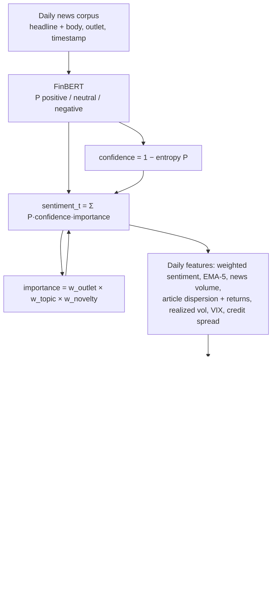

# LLM-HMM: Importance-Weighted News Sentiment for HMM Market Regime Detection

**Status:** research proposal (draft v0.1)

## One-paragraph pitch

Hidden Markov models detect market regimes (bull/bear) from price and volatility, but they only
react *after* a regime change shows up in returns. News leads prices, yet raw daily news sentiment
is dominated by high-volume, low-importance articles and miscalibrated model output, which is one
reason sentiment-only predictors stall near 55–60% directional accuracy. This project feeds
article-level news observations — weighted by a **news importance prior** (outlet credibility ×
news type × novelty) and **LLM confidence** (FinBERT sentiment, confidence = 1 − class entropy) —
into a **PCA-HMM** emission process, and evaluates whether the resulting regime detection is
*faster and more profitable* than a price-only HMM, using simple trading strategies and portfolio
allocation models.

## Motivation

- HMM regime detection on price/volume is mature (Hamilton 1989 → Rydén et al. 1998 → Nystrup et
  al. 2019) but backward-looking by construction.
- News sentiment demonstrably moves markets (Tetlock 2007; Garcia & Norli 2021), but aggregate
  sentiment series drown important articles in noise.
- We attack the measured noise component directly: down-weight unimportant outlets/topics and
  low-confidence predictions, then test whether the regime model times transitions earlier.

## Key contributions

1. First pipeline feeding **importance- and confidence-weighted** article-level news observations
   into a PCA-HMM's emission process for macro regime detection (prior work uses sentiment as an
   exogenous regressor, or unweighted sentiment in direct predictors).
2. Evaluation shifted from direction accuracy to **regime-timing economics**: transition lead
   time, net-of-cost Sharpe, drawdown — across a strategy zoo (equity/bond switch,
   probability-weighted allocation, mean-variance, risk parity, vol targeting).
3. A **calibration study** of FinBERT confidence in the regime-detection context (does
   temperature-scaled confidence improve timing?).
4. A portable, ablatable **news importance scoring framework** (outlet prior × topic type × novelty).

## Pipeline

## Experimental setup

**Baselines (control group):** buy & hold SPY · 60/40 · price-only HMM (returns + vol) ·
raw unweighted FinBERT-sentiment HMM (the critical ablation) · PCA-HMM without news ·
Markov-switching GARCH · always-bull.

**Ablations:** drop confidence weighting · drop importance weighting · drop both ·
placebo (shift news +5 days forward — signal must vanish) · state-count sweep (2/3/4) ·
PCA component sweep.

**Metrics:** net Sharpe (after transaction costs), max drawdown, Calmar, turnover,
regime-transition F1 vs ground truth (NBER recessions, VIX>25 episodes), and the headline
metric — **transition lead time in days** vs the price-only HMM.

**Statistics:** Diebold–Mariano on Sharpe differences, McNemar on regime classification
agreement, walk-forward stability of transition matrices.

## Data

| Source | Role | Cost |
|---|---|---|
| GDELT DOC 2.0 API | Primary news corpus (2017+, outlet domains, timestamps) | Free |
| Alpha Vantage NEWS_SENTIMENT | Vendor sentiment + topics + source, to validate the FinBERT layer | Free tier / ~$50 mo |
| Stooq / Sharadar | SPY, IEF/AGG, VIX daily prices | Free |

## Hypothesis / ideal results

The confidence+importance-weighted PCA-HMM detects bear-market entries **3–10 days earlier**
than a price-only HMM, yielding ≥0.3 net Sharpe improvement and ≥20% drawdown reduction, with
ablations showing each weighting component contributes. A clean null result (weighting does not
improve timing after costs) is also a publishable finding against the sentiment-matters literature.

## Limitations

Lookahead bias (article timestamps vs market close) is the main validity threat · FinBERT
confidence is miscalibrated out-of-domain · HMM state count invites overfitting · outlet
credibility priors drift · multi-day timing edges may not survive transaction costs ·
index-level results may not generalize to single names · news data coverage starts 2017
(regime sample includes ~2 recessions).

## Relevant past papers

### HMM / regime detection
- **Hamilton (1989)**, *Econometrica 57(2)* — introduced Markov regime-switching for business
  cycles. *Gap:* two-state parametric model, no news, no ML estimation.
- **Rydén, Teräsvirta & Åsbrink (1998)**, *J. Applied Econometrics 13* — HMMs reproduce the
  stylized facts of daily returns. *Gap:* descriptive fit only, no trading evaluation.
- **Hassan & Nath (2005)**, *IEEE ISDA* — early HMM stock forecasting. *Gap:* price-only
  observations, no regime-timing evaluation.
- **Nguyen & Nguyen (2015)**, *Risks 3(4)* — HMM for stock selection. *Gap:* single assets, no
  news features.
- **Nystrup et al. (2019)**, *JRFM 13(12):311* — regime-switching factor investing with HMMs,
  with live retraining. *Gap:* price/vol observations only; news absent.
- **SSRN 3406068 (2019)** — market regime identification with HMM. *Gap:* same price-only scope.
- **arXiv:2307.00459 (2023)** — PCA + HMM for stock return forecasting. *Gap:* no sentiment/news.
- **Elliott, van der Hoek & Malcolm (2005)** — HMM approaches to pairs trading. *Gap:*
  price-spread observations, no exogenous text signal.

### News sentiment & markets
- **Tetlock (2007)**, *Journal of Finance 62(3)* — media content predicts short-horizon market
  moves. *Gap:* bag-of-words on a single column; no regime model.
- **Garcia & Norli (2021)**, *JFE 141(2)* — most news tone is noise for prediction. *Gap:*
  motivates our importance weighting but does not build it.
- **Araci (2019)**, arXiv:1908.10063 — FinBERT: financial-domain sentiment transformer. *Gap:*
  classifier only; confidence miscalibration unexamined downstream.
- **JRFM 18(8):412 (2025)** — FinBERT sentiment alone stalls at ~55–60% directional accuracy on
  index direction. *Gap:* the accuracy ceiling our weighting scheme attacks.
- **J. Behavioral Finance (2016)** — media sentiment in a regime-switching return/vol model.
  *Gap:* sentiment as exogenous regressor, not HMM emissions; no article-level weighting.

### Closest work
- **PLOS ONE (2025), pone.0331658** — PCA-HMM on tech stocks including an investor-sentiment
  series; finds sentiment dominates momentum/volume. *Gap:* generic aggregate sentiment index —
  no article-level FinBERT, no confidence or importance weighting, no trading/portfolio
  evaluation. **This is the paper to cite as nearest-neighbor and differentiate against.**
- **TechRxiv: source credibility in LSTM stock prediction** — weights sentiment by source
  credibility. *Gap:* LSTM direct prediction; no regime model, no economic evaluation.
- **FusionLSTM-CNF (2025)** — confidence-calibrated weighting of FinBERT in a multi-modal LSTM.
  *Gap:* fusion for direct prediction; no HMM, no regime timing.
- **Mathematics 13(17):2747 (2025)** — FinBERT sentiment features with SHAP for stock
  prediction. *Gap:* supervised direct prediction, no regime detection.

## License

TBD
